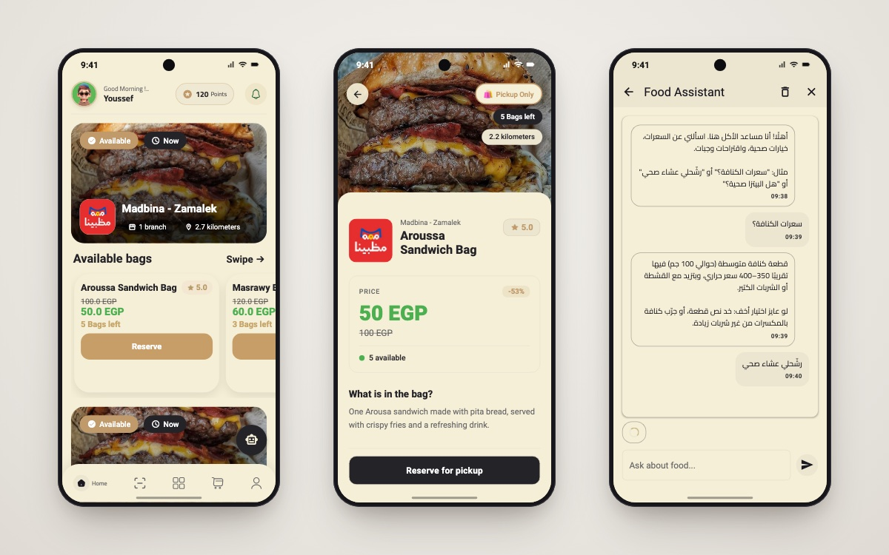

<h1 align="center">MysteryBag</h1>

<p align="center">
  <b>Save food. Save money.</b><br/>
  A Flutter app for buying discounted surplus-food "mystery bags" from local restaurants — with an on-device TensorFlow Lite food classifier and a Gemini-powered food assistant.
</p>

<p align="center">
  
  
  
  
  
  
</p>

<p align="center">
  
  <br/><sub>Home · Bag details · AI food assistant</sub>
</p>

---

## 📖 About

**MysteryBag** is the final project of the CiC program. Restaurants put their unsold, still-good food into discounted mystery bags; users reserve a bag and pick it up — less food waste, cheaper meals. On top of a full e-commerce flow (auth, cart, checkout, reviews, points), the app adds two AI features: a **TensorFlow Lite model that recognises the dish from a photo on-device**, and a **Gemini vision check** that looks for signs of spoilage, plus a food-only AI chat assistant.

## ✨ Features

- 🔐 **Authentication** — email/password, Google and Facebook sign-in (Firebase Auth)
- 👋 **Onboarding** and splash flow
- 🍱 **Restaurants & mystery bags** — available bags, bags left, old vs. new price (EGP), bag details, "reserve for pickup"
- ⭐ **Reviews** — streamed live from Firestore, with average rating and review analytics
- 🛒 **Cart & checkout** — cash on delivery, PayPal, or Visa card (`flutter_credit_card`)
- 🎁 **Points & rewards** — points balance with a rewards & discounts page
- 📸 **Food scan** — on-device TFLite classifier (2,000+ dish labels, 224×224 input), then a Gemini vision analysis in Arabic: verdict, visible signs and a safety tip
- 💬 **AI food chat** — Gemini chat with keyword rules that keep it on food topics (calories, healthy choices, suggestions)
- ❤️ Favourites, avatar picker, profile
- 🌍 **English / Arabic** localization and 🌙 **light / dark** theme

## 🛠 Tech stack

| Concern | Choice |
|---|---|
| Framework | Flutter, Dart 3 |
| State management | `bloc` / `flutter_bloc` (Cubits) + `provider` |
| Architecture | Feature-first Clean Architecture (data / domain / presentation), `get_it` DI, `dartz` `Either` errors |
| Backend | Firebase Auth, Cloud Firestore, Cloud Functions |
| On-device ML | `tflite_flutter`, `image` (model in `assets/tflite/`) |
| Generative AI | Gemini via a proxy — Firebase Function (`functions/`) or Cloudflare Worker (`worker.js`) — so the API key stays server-side |
| Payments | `flutter_paypal_payment`, `flutter_credit_card` |
| Localization | `flutter_localizations` + ARB files (`gen-l10n`) |
| Other | `shared_preferences`, `flutter_phoenix`, `dots_indicator`, `image_picker`, `crypto` |

## 🏗 Project structure

```
lib/
├── core/
│   ├── cubits/         # locale, theme, avatar
│   ├── entities/ models/ repos/   # products, restaurants, bags, reviews, orders
│   ├── services/       # Firebase auth, Firestore, prefs, get_it
│   └── widgets/ utils/ helper_functions/
├── features/
│   ├── auth/  onBoarding/  splash/
│   ├── home/           # restaurants, bags, cart, profile, points, reviews
│   ├── check_out/      # cash / PayPal / Visa
│   ├── food_scan/      # TFLite classifier + Gemini vision
│   └── ai_chat/        # Gemini food assistant
└── l10n/               # app_en.arb, app_ar.arb
assets/tflite/          # food_model.tflite + labels.txt
functions/              # Express API: POST /chat, POST /vision
worker.js               # Cloudflare Worker version of the same proxy
```

## 🚀 Getting started

**Prerequisites:** Flutter SDK (Dart `^3.10`), a Firebase project, and a Gemini API key for the AI features.

```bash
git clone https://github.com/youssef336/CiC_final_project.git
cd CiC_final_project
flutter pub get
flutter run
```

**Configuration**
1. **Firebase** — run `flutterfire configure` to use your own project.
2. **Gemini proxy** — either deploy `worker.js` to Cloudflare Workers with a `GEMINI_API_KEY` secret, or deploy `functions/` after setting `firebase functions:config:set gemini.key=...`. Then update `_proxyBaseUrl` in `lib/features/ai_chat/presentation/views/ai_chat_view.dart` and `lib/features/food_scan/presentation/views/food_scan_view.dart`.
3. **PayPal** — use your own sandbox credentials in `lib/core/utils/app_key.dart`.

## 👤 Author

**Youssef Belal Zakaria** · [GitHub @youssef336](https://github.com/youssef336)

⭐ If you like this project, give it a star!
